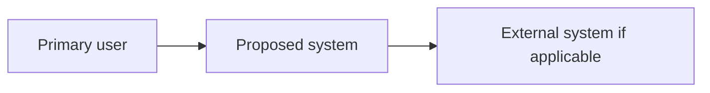

> TEMPLATE ONLY · NOT A PROJECT DOCUMENT
>
> При создании в `deliverables/` удалите это предупреждение и заполните метаданные.
> Не подменяйте `UNKNOWN` догадкой. `APPROVED` возможен только после явного согласия владельца.

- **Project:** TBD
- **Version:** 0.1
- **Status:** DRAFT
- **Author:** Codex (prepared for owner review)
- **Reviewed/approved by:** NOT APPROVED
- **Date:** YYYY-MM-DD
- **Sources:** `workspace/SOURCES.md`, `workspace/DECISIONS.md`

# Architecture Decision Pack

## Context and drivers
Approved product and SRS versions, constraints, scale assumptions, security/operability requirements.

## Alternative evaluation
| Option | Why viable | Complexity/cost | Failure domains | Security | Lock-in | Reversibility | Decision |
|---|---|---|---|---|---|---|---|
Include simpler default option. Never assume distributed microservices by default.

## C4 Context (Mermaid)

Replace generic placeholders with domain-grounded entities once known. Then produce container/component diagrams as needed.

## Domain and boundaries
Bounded contexts, aggregates/invariants, cross-context consistency, transaction strategy, coupling map.

## Data architecture
Storage choices, ownership, indexing/query needs, schema migration, retention/delete, backup/restore, privacy.

## Contracts
API/event contract conventions: versioning, auth, idempotency, errors, retry/DLQ, backward compatibility, schema evolution, quotas.

## Threat model
Trust boundaries, assets, abuse cases, mitigations, residual risks, verification and owner.

## Runtime and operations
Environments, CI/CD, deployment topology, logs, metrics, traces, health, capacity, SLO targets if confirmed, DR and rollback.

## Costs, limitations and evolution path
Complexity tax, team skills, scaling thresholds for decomposition, build/buy decisions and exit plan.

## ADR index
Link `deliverables/adr/ADR-*.md`, status APPROVED/PROPOSED and explicit owner decision.

## Architecture acceptance
Tests/spikes needed to prove decisions; known blockers; owners and stage gate.
